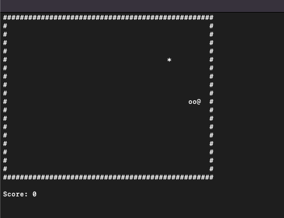

# Terminal Snake Game 🐍

A classic Snake game built for the terminal using Go.

## 🎮 How to Play

- **WASD** or **Arrow Keys** - Move the snake
- **Q** - Quit the game
- Eat `*` to grow and increase your score
- Don't hit the walls `#` or your own tail!

## 🚀 Quick Start

```bash
# Clone the repo
git clone https://github.com/mahimshridhar/snake
cd snake-game

# Run the game
go run main.go

# Or build and run
go build -o snake
./snake
```

## 📸 Preview


